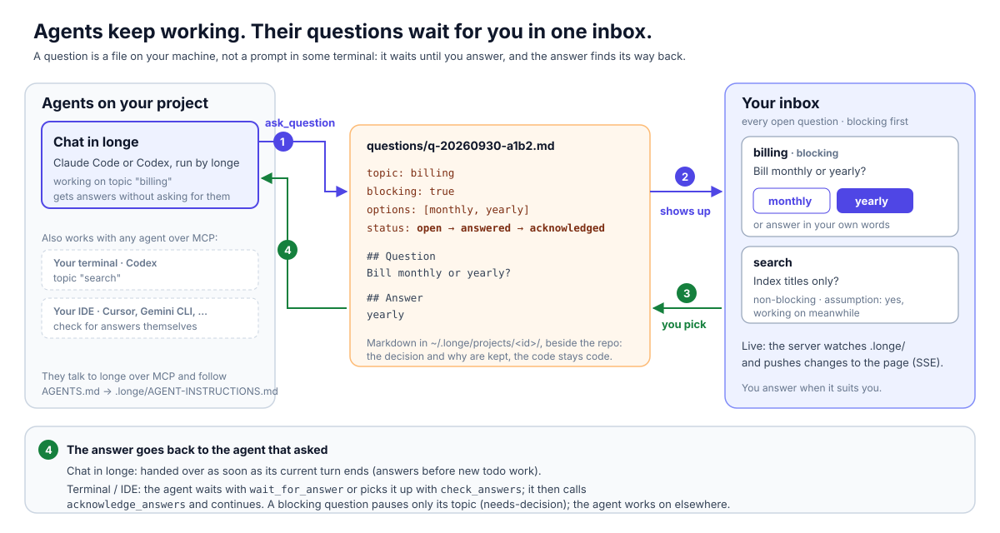
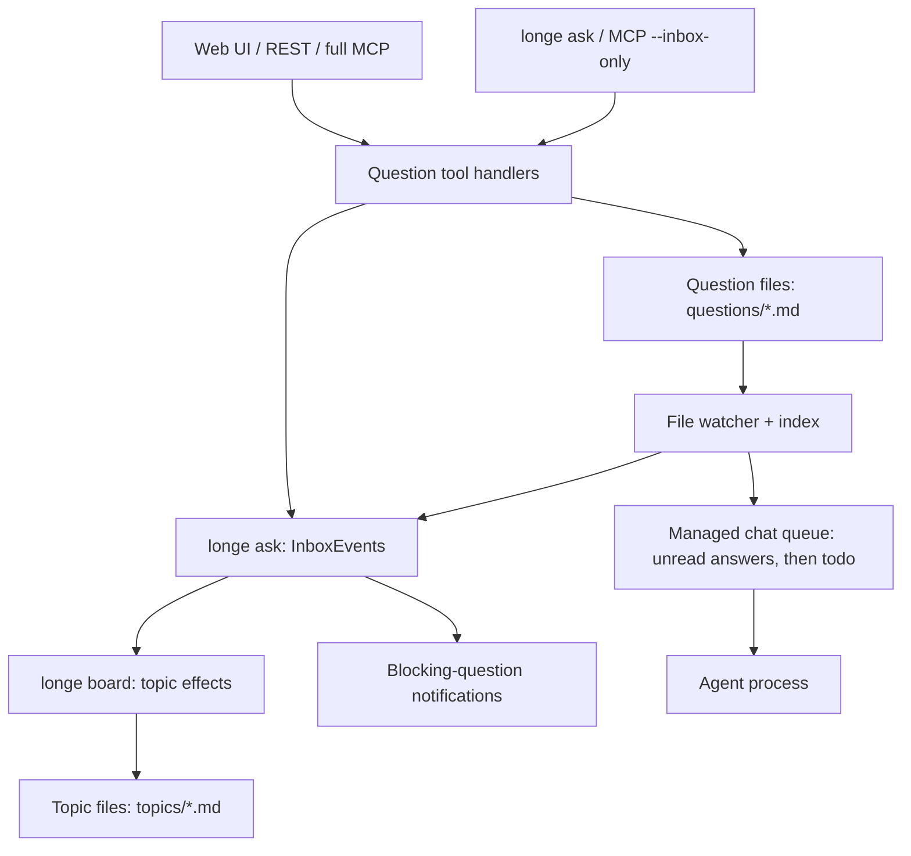

# How longe ask and longe board work

longe connects the work you ask for, the decisions an agent needs, and the answers that let it
continue. You get one inbox across repositories. Each repository keeps its own topics, chat
and record of what happened.

**longe ask** owns questions, answers, waiting and notifications. It can be used without
tracking topics. **longe board** owns the topic workflow and managed chat; it consumes Ask's
events to react when a topic needs input or receives a review answer. **Inbox** is the name
of the question-list UI shared by both.

The diagram is plain SVG ([source](assets/architecture.svg)); see [assets/README.md](assets/README.md)
for a PNG export.

## Module boundary and event flow

The question module lives in `src/inbox/`; it imports no board module. The application
context wires its event bus to `src/board/question-effects.ts` and the notification listener.
Question operations save the file and refresh the index before emitting `asked`, `answered`
or `withdrawn`. The file watcher emits the same events for edits made outside those operations;
expected-state tracking avoids repeating effects for the process's own writes.

Listeners run in subscription order and are awaited: board effects first, then notifications.
A listener failure is logged and does not undo the saved answer or fail the question operation.
Acknowledgment changes the question's read state; it is not another review decision.

Subjects connect the parts without requiring every question to be a topic. An Ask client can
use `{ "kind": "pr", "id": "128" }`, another subject kind, or no subject. A subject of kind
`topic` refers to an existing board topic and enables the board's status reactions. Existing
`topic: <id>` frontmatter remains supported and is still written for topic-linked questions;
other subjects use the `subject` field. Review options on a non-topic question do not move
a topic.

The split is an internal module boundary, not two packages or isolated runtimes. Entry points
still create the shared application context, index and `Repo` store. Default `longe mcp` and
HTTP MCP expose both parts; `longe mcp --inbox-only` exposes only question tools over stdio.
The inbox-only client does not receive the board's agent-protocol resource. `longe ask` invokes
those inbox tools directly from the shell, without an MCP client. `longe board` is a capability
name; the command that starts the web interface remains `longe serve`.

## One task, from request to review

Suppose you ask an agent to add a settings screen.

1. **You send the request.** A Chat message is saved before delivery to the agent. A message
   from a topic page carries that topic's context. You can also queue a topic as todo.
2. **The agent tracks the work.** The topic holds its goal, plan, decisions and log. If the
   agent needs input, it calls `ask_question` with the question, context and options.
3. **You decide in the inbox.** For example: “Should these settings apply to this project or
   all projects?” Choose an option, add a note, or write a different answer. The question and
   answer live together in one file.
4. **The agent receives the answer.** In the managed chat, longe waits until the current turn
   ends and sends new answers together. The agent calls `check_answers`, reads them, then
   calls `acknowledge_answers` and continues the affected topics.
5. **You review the result.** The agent records its changes and validation on the topic and
   moves it to review. You approve or send it back with feedback. Agents cannot approve
   their own work.

The topic tells you what happened; the inbox tells you what needs your attention.

## Two ways to ask

| Question | What the agent does | What you see |
| --- | --- | --- |
| **Blocking** — cannot proceed without your answer | Stops work on that topic; may work on another | The active topic moves to **needs-decision**; blocking questions appear first |
| **Non-blocking** — a reasonable default exists | States an **assumption** and continues on it | A question you can answer while work continues |

A blocking question without a topic still waits for an answer, but moves no board card.
A suggested option is not consent: it is only a choice until you submit an answer. A topic
waiting on several blocking questions returns to active only after the last one is answered
or withdrawn. A project-wide question can appear in the inbox without belonging to a topic.

Review questions can also name approval and rejection options. Choosing an approval option
moves a topic in review to done; choosing a rejection option returns it to active with your
feedback. Writing a custom answer to one of these review questions also returns the topic to
active. To approve, choose the approval option. This makes review part of the same inbox loop.

## Sent, answered, read

Messages and questions have different jobs:

| Record | Meaning | Location |
| --- | --- | --- |
| **Message** | A request from you, or a board-generated notice sent to the chat | `messages/` |
| **Question + answer** | A decision requested by an agent, your response, and whether it has been read | `questions/` |
| **Topic** | The goal, plan, decisions, log and current work status | `topics/` |

All three live in the project's board folder, `~/.longe/projects/<id>/`, outside the
repository; the `id` is in the repository's `.longe/config.yml`.

A question moves through **open → answered → acknowledged**. Answering saves your response;
acknowledging records that the agent has read it. Until then it remains available through
`check_answers`, and the board shows “answer waiting.” Acknowledgment does not mean the work
is finished. An agent can also withdraw an open question, with a reason, when it is no longer
needed.

The managed chat gives unread answers priority over new todo work. It sends them only while
the chat is free and has a session to receive them. When no topic is active, it can hand the
agent the next todo topic. Backlog stays parked until you choose to queue or activate it.

External agents use the same question files through MCP, REST or direct edits, but need to
check for answers themselves, wait with `wait_for_answer`, or use a configured integration.
Shell clients can use `longe ask "Question?" --option Yes --option No --wait 120` to wait for
the answer. With `--wait`, exit 0 means answered, 3 means the wait timed out, and 4 means the
question was withdrawn. A timeout leaves the question open. Without `--wait`, exit 0 means
the question was created, and the output is its id. The CLI does not acknowledge an answer
on the caller's behalf. Desktop notifications are sent by a running `longe serve`, not by
the short-lived CLI process.

If `hooks.on_answer` is configured, that hook handles answer wake-ups instead of the managed
chat's automatic answer delivery. Merely connecting an external agent over MCP does not give
it automatic push delivery.

## What survives a restart

Requests, questions, answers and topic records are markdown files. The UI watches those files;
they are the source of truth, not a separate database. You can inspect and edit them in the
board folder. Unacknowledged answers remain available after restarting longe.

The live assistant transcript is a runtime view. Chat message files store what you or the
board sent to the agent; they are not a complete archive of its streamed replies. The agent
must put lasting results in the topic's **Log** and **Decisions**. Provider session references
are cached separately so the chat can resume.

A message's `delivered_at` field is delivery bookkeeping, not proof that the agent completed
the request. It is not an exactly-once execution guarantee. The topic's progress and your
review determine whether the work is complete.

## Where the logic lives

| Responsibility | Implementation |
| --- | --- |
| Save messages and mark delivery | [messages.ts](../src/store/messages.ts) |
| Deliver chat messages and resume provider sessions | [agent.ts](../src/app/agent.ts) |
| Send unread answers before todo work | [todo-queue.ts](../src/app/todo-queue.ts) |
| Question types, validation and generic subjects | [types.ts](../src/inbox/types.ts), [schema.ts](../src/inbox/schema.ts), [subject.ts](../src/inbox/subject.ts) |
| Read and serialize question files | [store.ts](../src/inbox/store.ts) |
| Answer, acknowledge or withdraw a question | [ops.ts](../src/inbox/ops.ts) |
| Publish awaited question events | [events.ts](../src/inbox/events.ts) |
| Build the shared Inbox view and notifications | [view.ts](../src/inbox/view.ts), [notify.ts](../src/inbox/notify.ts) |
| Block, unblock, approve or return a topic | [question-effects.ts](../src/board/question-effects.ts) |
| Translate watched file changes into events and hooks | [effects.ts](../src/index/effects.ts) |
| Wire the board and notification listeners | [context.ts](../src/app/context.ts) |
| Expose inbox-only MCP tools and the shell command | [inbox-tools.ts](../src/tools/inbox-tools.ts), [ask.ts](../src/cli/ask.ts) |

[Back to the README](../README.md) · [Agent protocol](../src/domain/agent-instructions.ts)
